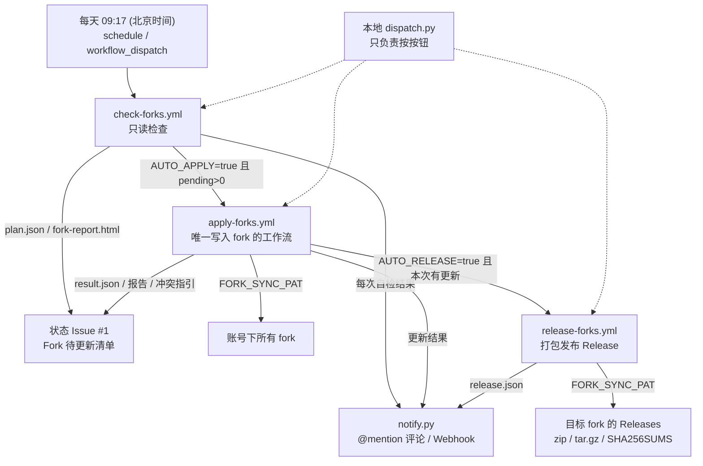

# fork-hub — GitHub fork 自动同步控制中心

一个用 GitHub 原生能力搭起来的「更新项目的项目」：**自动发现账号下所有 fork，比对上游，按规则同步更新**，并可在 fork 更新后**自动打包发布 Release**（HA 集成 / 软件 / 模块）。本地脚本不参与同步逻辑，只负责按按钮；真正的检查、写入与发布都跑在 GitHub Actions 云端。

状态与结果都留在本仓库，不需要服务器、不需要数据库、不需要常开的电脑。当前实例为公开仓库，逻辑对公开 / 私有均适用。

当前实例：`shinnaluo/fork-hub`，默认每天 **UTC 01:17 / 北京时间 09:17** 自检一次，全自动模式已开启。

---

## 一、更新规则（这个项目的核心）

三条铁律：

1. **我方修改过的功能提交，必须保留并合并进 fork 的更新里。**
2. **上游自己重写、回退、放弃的旧提交，以及 GitHub 自动 Sync/Merge 产生的噪声提交，不作为「我的改动」保守保留，我方 fork 同步放弃。**
3. **上游没有更新，fork 一律不动；任何写入前先建备份分支，随时可恢复。**

### 比对结果 → 采取的动作

| 分类 | fork 独有提交是什么 | 动作 | 强制推送 |
| --- | --- | --- | --- |
| `in_sync` 已同步 | 无 | 完全不动 | 否 |
| `local_only` 仅你有改动 | 你的功能 | 上游没新提交，原样保留，不动 | 否 |
| `fast_forward` 上游有更新 | 无 | `merge-upstream` 直接快进 | 否 |
| `diverged` 双方均有改动 | 你的功能 | 先建备份分支，再合并上游生成合并提交，**你的提交完整保留** | 否 |
| `upstream_rewritten` 上游重写历史 | 全是上游已放弃的旧提交 / 自动同步噪声 | 先建备份分支，再把分支对齐到上游 HEAD | **是（仅此情形）** |
| `diverged` 且混合 | 你的功能 + 被放弃的旧提交 | **保守保留**，不自动强推；报告里给 `git rebase --onto` 人工指引 | 否 |
| `archived` / `unknown` | — | 跳过（归档只读 / 上游不可访问） | 否 |

除 `upstream_rewritten` 的对齐外，**永不使用 force push，永不删除分支或提交**。

### 「是不是我的提交」怎么判定

早期版本把 fork 上所有独有提交一律当成「我的改动」，结果上游 `force push` / rebase 掉的旧提交会在 fork 里变成永久累赘。现在改为按提交作者来源判定：

1. 读取**上游默认分支最近 100 个提交**，把 `login` / `author email` / `committer email` 汇成「上游作者集合」（排除 `noreply@github.com`、`web-flow@` 等平台通用身份，并强制剔除本账号 login，避免你曾给上游提过提交时把自己误判成上游作者）。
2. 逐个检查 fork 独有提交：
   - 作者命中上游作者集合 → `discarded_upstream`（上游已放弃的旧提交）
   - GitHub 自动生成的 Sync fork 合并提交（双亲、平台 committer、`Merge branch ...` 等）→ `discarded_sync`（同步噪声）
   - **其他一律判为 `mine`（你的功能提交），保守保留**
3. 只有 `mine` 数量为 0 且被放弃的提交数大于 0 时，才归类 `upstream_rewritten` 并允许对齐；只要有 1 个 `mine`，就不强推。

这是**保守的启发式判定**：宁可多保留，绝不误删。若你恰好用与上游作者相同的邮箱提交，可能被误判为上游提交 —— 先看报告里的 `mine_commits` / `discarded_commits`，或用 `ON_REWRITE=keep`（云端）/ `--no-ownership`（本地）关闭该分析。

### 两个真实案例

- `midea_smart_home`：上游重写了 `staging` 历史，fork 里 3 个独有提交经识别为 2 个上游作者 `Cyborg2017` 的旧提交 + 1 个同步噪声，**没有一个是我的功能**。默认策略 `align` 建备份后对齐上游，fork 与上游 HEAD 一致，旧提交只留在 `backup/staging-before-rewrite-*` 里。
- `HA-Housekeeper`：中文化提交的作者不在上游作者集合，判为 `mine`。上游有更新时先建 `backup/main-before-upstream-*` 再生成合并提交，**我的功能提交完整保留**。

---

## 二、架构



- **check-forks.yml**：纯只读。自动发现 fork、比对上游、生成计划与 HTML 报告、刷新状态 Issue、推送自检通知。发现待更新项且全自动开启时，才派发 apply。
- **apply-forks.yml**：**唯一会修改 fork 分支的地方**。用 `FORK_SYNC_PAT` 执行同步，写回结果、生成冲突指引、推送更新结果通知；`AUTO_RELEASE=true` 时把本次实际更新的仓库派发给发布工作流。
- **release-forks.yml**：**打包发布工作流**。从目标 fork 默认分支下载源码，按类型打包并创建 Release；不改分支、不删提交。手动 / 定时 / 由 apply 派发三种触发方式。
- **状态 Issue**：自动维护的「Fork 待更新清单」，正文分成「检查结果」「更新结果」两个带标记的块，谁运行谁替换自己的块，另一块原样保留。
- **本地脚本**：`dispatch.py` 触发/查看云端工作流；`fork-sync/fork_updater.py` 是同一套逻辑的本地独立版本，可完全脱离云端使用。

### 文件清单

| 文件 | 作用 |
| --- | --- |
| `.github/workflows/check-forks.yml` | 定时 + 手动触发的只读自检 |
| `.github/workflows/apply-forks.yml` | 手动 / 自动派发的 fork 写入 |
| `fork_updater.py` | 核心逻辑：发现、比对、归属分析、冲突预检、更新、复核、报告 |
| `sync_issue.py` | 把计划 / 结果写回状态 Issue |
| `notify.py` | 每次自检与更新后的结果推送 |
| `dispatch.py` | 本地「按按钮」脚本（check / apply / release / runs） |
| `release_builder.py` | 打包发布核心：下载 fork 源码、识别类型、生成资产、创建 Release |
| `release-targets.json` | 发布目标清单与打包规则（HA 集成 / 软件 / 模块） |
| `.github/workflows/release-forks.yml` | 定时 / 手动 / 自动派发的打包发布工作流 |

本机 `fork-sync/` 目录是同一套逻辑的本地副本，另附 `check-forks.bat`、`update-forks.bat` 两个双击启动器和 `conflict-guide.example.md`。

---

## 三、部署与配置

### 前置条件

- 一个 GitHub 账号、一个仓库（公开 / 私有均可；本实例 `shinnaluo/fork-hub` 当前为公开，默认分支 `main`，**开启 Issues**）。
- 一枚 PAT：`FORK_SYNC_PAT`。classic PAT 需 `repo` + `workflow` scope；fine-grained PAT 需覆盖 **All repositories**，权限含 Contents read/write、Metadata read、Actions write。
  - Actions 自带的 `GITHUB_TOKEN` **只作用于当前仓库**，无法写入其他 fork，必须用 PAT。
  - PAT 有有效期，到期后自检会失败，记得续期并更新 secret。

### Secrets 与 Variables

| 位置 | 名称 | 值 | 说明 |
| --- | --- | --- | --- |
| Secret | `FORK_SYNC_PAT` | PAT | 必填，唯一跨仓库写入凭据 |
| Secret | `NOTIFY_WEBHOOK` | URL | 可选，不配置则只用 GitHub 通知 |
| Variable | `AUTO_APPLY` | `true` / `false` | `true` 为全自动：自检有待更新项就自动派发 apply |
| Variable | `AUTO_RELEASE` | `true` / `false` | `true` 开启自动发布：每天 UTC 02:27 打包全部目标；配合 `AUTO_APPLY` 时只发布本次实际更新的 fork |
| Variable | `ON_REWRITE` | `align`（默认）/ `keep` | `keep` 可关闭「对齐上游重写历史」，回到一律保留旧行为 |
| Variable | `NOTIFY_SCOPE` | `final`（默认）/ `both` | `final`：全自动时只推 apply 的最终结果一条；`both`：check 与 apply 各推一条 |
| Variable | `NOTIFY_LEVEL` | `all`（默认）/ `changes` | `changes`：只在有变化或异常时推送 |
| Variable | `NOTIFY_MENTION` | 用户名 / `none` | 通知里 @ 谁，默认仓库 owner；`none` 关闭 @ |

`NOTIFY_WEBHOOK` 按 URL 自动适配 Server酱、Bark、企业微信机器人、钉钉机器人、飞书机器人、通用 JSON。脚本不会打印完整 URL。

### 首次使用

1. 在 Actions 页面**手动 Run workflow 一次** `check forks`。工作流必须先成功运行过一次，API 才能通过 `workflow_dispatch` 触发它。
2. 确认 `FORK_SYNC_PAT` 有效：`apply fork updates` 运行时会先校验 PAT 归属与 scopes。
3. 想收到邮件：GitHub → Settings → Notifications 勾选 **Email**、**Participating, @mentions and custom**，并 **Watch** 本仓库。通知是通过状态 Issue 的 @mention 评论触发的。
4. 想在看板里跟踪：可新建一个 GitHub Project，把状态 Issue 加进去（可视化载体，不影响同步逻辑）。

---

## 四、怎么用

### 全自动（当前配置）

每天 09:17 自检 → 有更新就自动 apply → 结果写回状态 Issue 并推送通知。你什么都不用做，只在**出现真冲突**时按第五节处理。

### 手动（本地按按钮）

```bash
cd fork-hub
python dispatch.py check                      # 触发一次检查
python dispatch.py check --auto-apply         # 检查后若有待更新项，自动触发更新
python dispatch.py apply                     # 手动触发更新（默认 keep 策略）
python dispatch.py apply --only BiliPai --on-conflict skip
python dispatch.py apply --fail-on-conflict  # 真冲突时让 run 标红，方便收到通知
python dispatch.py runs                      # 查看两个工作流最近的运行
```

也可以在 GitHub Actions 页面直接点 `Run workflow`，`apply fork updates` 支持 `on_conflict` / `only` / `fail_on_conflict` 三个输入。

### 完全本地（不依赖云端）

```bash
cd fork-sync
check-forks.bat                                  # Windows 双击：只检查
update-forks.bat                                 # Windows 双击：先出计划，输入 y 才执行
python fork_updater.py --apply --yes             # 无人值守
python fork_updater.py --only BiliPai,ha-lixiang
python fork_updater.py --apply --on-conflict skip
python fork_updater.py --on-rewrite keep        # 兼容旧行为，不清理被上游放弃的历史
```

凭据优先读环境变量 `GITHUB_TOKEN` / `GH_TOKEN`，否则从本机 Git Credential Manager 读取；脚本不保存、不打印令牌。

### `fork_updater.py` 常用参数

| 参数 | 作用 |
| --- | --- |
| `--apply` | 实际执行（默认只预览，不写任何东西） |
| `--yes` | 跳过交互确认，配合 `--apply` 用于定时任务 |
| `--only` / `--exclude` | 只处理 / 排除指定仓库名，逗号分隔 |
| `--on-conflict keep\|skip\|upstream` | 冲突策略，默认 `keep`（`upstream` 会丢弃自有提交，慎用） |
| `--on-rewrite align\|keep` | 上游重写历史策略，默认 `align` |
| `--no-ownership` | 关闭提交来源分析（少发 API 请求，此时不会做对齐） |
| `--no-precheck` | 关闭同名文件冲突风险预检 |
| `--json` / `--report` / `--guide` | 导出 JSON 结果、HTML 报告、冲突处置指引的路径 |
| `--workers` | 并发请求数，默认 6 |

---

## 五、自动打包发布 Release

把某个 fork 的源码打包成可直接使用的资产，并发布到**该 fork 自己的 Releases**：

- `ha-integration`：zip 内是 `<domain>/manifest.json` 结构，符合 HACS 自定义集成目录要求；打包时把 `manifest.json` 版本同步为本次版本（不改仓库源文件）。
- `module`：Magisk / KernelSU 模块，`module.prop` 等文件在 zip 根目录，可直接刷入。
- `software`：整个仓库根目录打包，排除 `.git` / `.github` / `node_modules` 等。

每个目标产出 `<名称>-<版本>.zip`、`.tar.gz`、`SHA256SUMS` 三个资产。只创建 Release 与资产，**不改分支、不删提交**。

### 配置目标

编辑 `release-targets.json`：

```json
{
  "owner": "shinnaluo",
  "branch": "main",
  "tag_pattern": "{repo}-v{version}",
  "targets": [
    {"repo": "ha-chuanglvjia", "kind": "ha-integration",
     "path": "custom_components/chuanglvjia", "branch": "main"}
  ]
}
```

- `kind` 省略时自动识别：根目录有 `module.prop` → `module`；有 `custom_components/<domain>/manifest.json` → `ha-integration`；其余 → `software`。
- `path` 省略时自动定位：HA 集成取唯一的 `custom_components/*`；其余取仓库根目录。
- `branch` 默认分支不一致时单独指定（如 `XiaomiGateway3` 是 `master`）。
- `include` / `exclude` 可覆盖默认的 glob 过滤规则；`wrap: false` 可关闭 HA 集成的外层目录。
- `tag_pattern` 支持 `{repo}`、`{version}`、`{domain}`、`{kind}` 占位符。

当前默认清单：`ha-chuanglvjia`、`XiaomiGateway3`、`magisk-tailscaled`、`mi-gpt`。

### 三种触发方式

```bash
python dispatch.py release                               # 打包配置里的全部目标
python dispatch.py release --only ha-chuanglvjia --version 1.2.3
python dispatch.py release --dry-run                     # 只打包，不发布
python dispatch.py release --force                       # 标签已存在时更新 Release 并覆盖同名资产
```

- **手动**：Actions → `release forks` → Run workflow，支持 `only` / `version` / `dry_run` / `force` 输入。
- **定时**：设 Variable `AUTO_RELEASE=true`，每天 UTC 02:27（北京时间 10:27）打包全部目标。
- **跟更新联动**：同时开启 `AUTO_APPLY=true` 与 `AUTO_RELEASE=true`，apply 完成后只把本次真正更新的仓库交给发布工作流，避免重复发布。

版本留空时使用 UTC 时间戳 `YYYYMMDD.HHMM`。标签已存在默认跳过；显式 `--force` 才会更新已有 Release。发布结果写入 `release.json`，通知走状态 Issue / Webhook（与同步结果同一套通道）。

### 本地验收

```bash
python release_builder.py --dry-run --only ha-chuanglvjia --version 1.2.3
```

产物在 `dist/<repo>/`，可直接解压检查目录结构；`--dry-run` 不需要 PAT，也不写任何仓库。

---

## 六、遇到冲突怎么办

GitHub 的 `merge-upstream` 在内容冲突时返回 **409** 且不会改动 fork，所以脚本永远不会把你的提交冲掉。但「哪一行该保留」只有你能决定，脚本的选择是：**停下 + 备份 + 报告 + 给出可复制的解决命令**，而不是蛮干。

默认 `keep` 策略下的流程：

1. 先创建 `backup/<分支>-before-upstream-<时间戳>` 备份分支。
2. 尝试合并上游；成功则生成合并提交，你的改动保留（实测 `HA-Housekeeper` 双方改过 8 个同名文件，服务端仍自动合并成功，所以「同名文件」只是风险提示，不等于冲突）。
3. 若 409：fork 保持更新前状态，报告与 `conflict-guide.md` 里给出网页 PR、本地 merge、abort、备份恢复、彻底跟随上游这几套命令；状态 Issue 标题会打上「需人工处理」并且**不会自动关闭**。

解决示例（本地命令行）：

```bash
git clone https://github.com/<owner>/<repo>.git
cd <repo>
git remote add upstream https://github.com/<upstream-owner>/<repo>.git
git fetch --no-tags upstream main
git checkout main
git merge upstream/main      # 编辑冲突文件，删掉冲突标记
git add -A && git commit -m "merge upstream, keep my changes"
git push origin main
```

从备份分支恢复：

```bash
git checkout -b restore origin/backup/main-before-upstream-<时间戳>
```

处理完再跑一次 `python fork_updater.py` 复核：落后数应归零，自有提交仍在。

> `upstream` 策略与 `--on-conflict upstream` 会在已有备份的前提下强制对齐上游、**丢弃全部自有提交**，仅在明确需要彻底跟随上游时使用，定时任务慎用。

---

## 七、结果通知

每次自检与每次更新结束后，`notify.py` 都会推送一条结果，包含：本次检出的 fork 总数、待更新数、已更新数、需人工处理的冲突数、备份分支、复核落后数、Actions 运行链接。

三条通道：状态 Issue 的新评论（带 @mention，触发站内/邮件通知，同时按时间留下自检日志）、可选的 `NOTIFY_WEBHOOK`、Actions 页面上的 Step Summary。**通知失败绝不影响 fork 同步结果**，`if: always()` 保证自检失败时也会告知。

---

## 八、注意事项与常见问题

- **定时任务会漂移**：GitHub 的 `schedule` 不保证准点，高峰期可能延迟；公共仓库 60 天无仓库活动会自动停用定时任务（本实例当前为公开，但每日有定时活动，不会触发停用）。
- **想关掉全自动**：把 Variable `AUTO_APPLY` 改为 `false`，自检会照常进行、刷新状态 Issue，但不再自动 apply，由你手动点按钮。
- **PAT 过期 / 权限不足**：apply 会在第一步报「缺少 FORK_SYNC_PAT」或 403，检查 PAT 有效期与 scope，更新 Secret 即可，历史数据不会丢。
- **上游删库 / 私有化 / 改默认分支**：会归类为 `unknown` 并跳过，不会误写 fork。注意上游默认分支不一定是 `main`（例如 `midea_smart_home` 是 `staging`），脚本按 API 返回的默认分支比对。
- **已归档 fork**：只读，跳过。
- **API 速率限制**：脚本带重试与并发控制（`--workers` 默认 6），fork 数量多时可适当调低。
- **同步触发的 CI 失败**：与本次同步逻辑无关。例如 `BiliPai` 的 Build 因上游自身 Kotlin 编译错误失败，`TraeTools` 每日签到因 Cookie 过期 401，这些需要在对应项目里修，不是 fork 同步能解决的。
- **报告在哪**：每次运行的 Actions artifact 里有 `plan.json` / `fork-report.html`（保留 14 天）和 `result.json` / `fork-update-report.html` / `conflict-guide.md`（保留 30 天），状态 Issue 里也能直接看结论。

## 九、安全边界

- `GITHUB_TOKEN` 只用于本仓库的 Issue 与工作流派发，跨仓库的读写全部交给 `FORK_SYNC_PAT`。
- 不删除分支、不删除提交、除 `align` 对齐外不强推；`align` 之前必定先建备份分支。
- 写入后逐仓复核 `ahead` / `behind`，结果写进 `result.json` 与状态 Issue。
- 令牌只从环境变量或系统凭据管理器读取，不落盘、不打印、不写进日志。
- 发布工作流只在目标 fork 创建 / 更新 Release 与资产，不推送分支、不删除任何提交；`--force` 仅覆盖同名 Release 资产。
- `--dry-run` 全程匿名可读公开仓库即可，不接触任何写接口，适合先验收打包结果。
